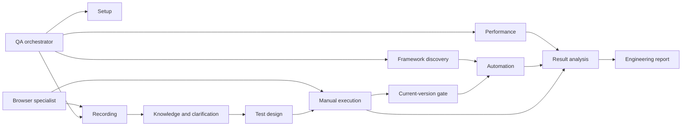

# Small components with explicit handoffs

Orchestrator routes requested work rather than forcing every stage. Skill = reusable procedure; agent = focused role that loads that procedure; recorder = executable browser capture. Shared contract defines artifact identity, state, privacy, approvals and gate semantics. Hosts without native specialist agents execute roles sequentially.

- qa-setup: dependency detection and approved installation.
- qa-playwright / qa-browser: browser and API tool operation.
- qa-recording: passive demonstration capture and session lifecycle.
- qa-knowledge: guided business understanding and versioned manual flows.
- qa-framework: framework architecture, features, data wiring and CI inventory.
- qa-test-design: coverage, scenarios and traceability.
- qa-test-execution: selected manual cases, evidence and owned test data.
- qa-automation: existing framework changes after the evidence gate/explicit override.
- qa-performance: k6/JMeter scripts and confirmed run profiles.
- qa-analysis: evidence normalization and independent cause scores.
- qa-reporting: engineering document from established analysis.
- qa-orchestrate: routing/state/handoffs only.

One writer per artifact, selected IDs and versions in every handoff, no specialist loads every other skill. Shared contract copies are generated from contracts/CONTRACT.md; after changing it synchronize skill reference copies and validate. Portable catalogs are not native platform config schemas. Native format/locations are cited in INSTALLATION.md. Browser API implementation follows the official [BrowserContext documentation](https://playwright.dev/docs/api/class-browsercontext).

The gate helper checks local records and evidence but does not intercept every host's edit tools. Agents must call it before automation edits. Enterprise enforcement against bypass/tampering would require an approved host hook or signed execution/approval service, which is outside this package's scope.

# Engineering extension

qa-engineering routes to qa-performance-engineering or qa-rca. Performance engineering coordinates qa-workload-model → qa-performance / qa-mcp-neoload → qa-telemetry-correlation → qa-bottleneck-analysis → qa-fix-proposal → approved qa-fix-implementation → qa-performance-retest. Formal RCA labels require mechanism proof and agreement across logs, traces, metrics and code analysis. Each MCP product owns its bounded reads and explicitly approved writes. Jira/Confluence share an integration where appropriate but have separate content/workflow roles.

Total: 26 short skills and 26 roles. One skill per responsibility and selected references only. Existing qa-analysis/reporting still own normalization and final reports. See contracts/ENGINEERING.md for artifact identity, approval and evidence rules; integrations/SETUP.md for verified sources/template limitations; docs/GAP-REVIEW.md for residual gaps.

Browser ownership is mandatory across all roles: each recording/UI session owns a dedicated spawned process and QA-only profile; the browser specialist verifies ownership before actions. Unavailable launch capability blocks browser-dependent work. Integrated browsers and personal/shared browser attachments are excluded.
