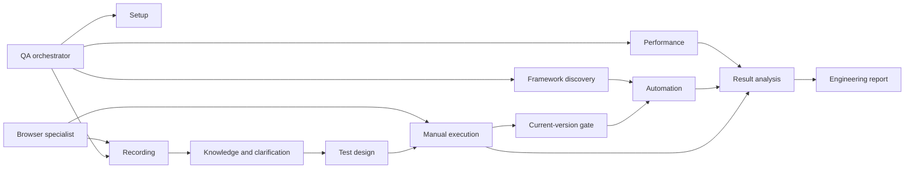
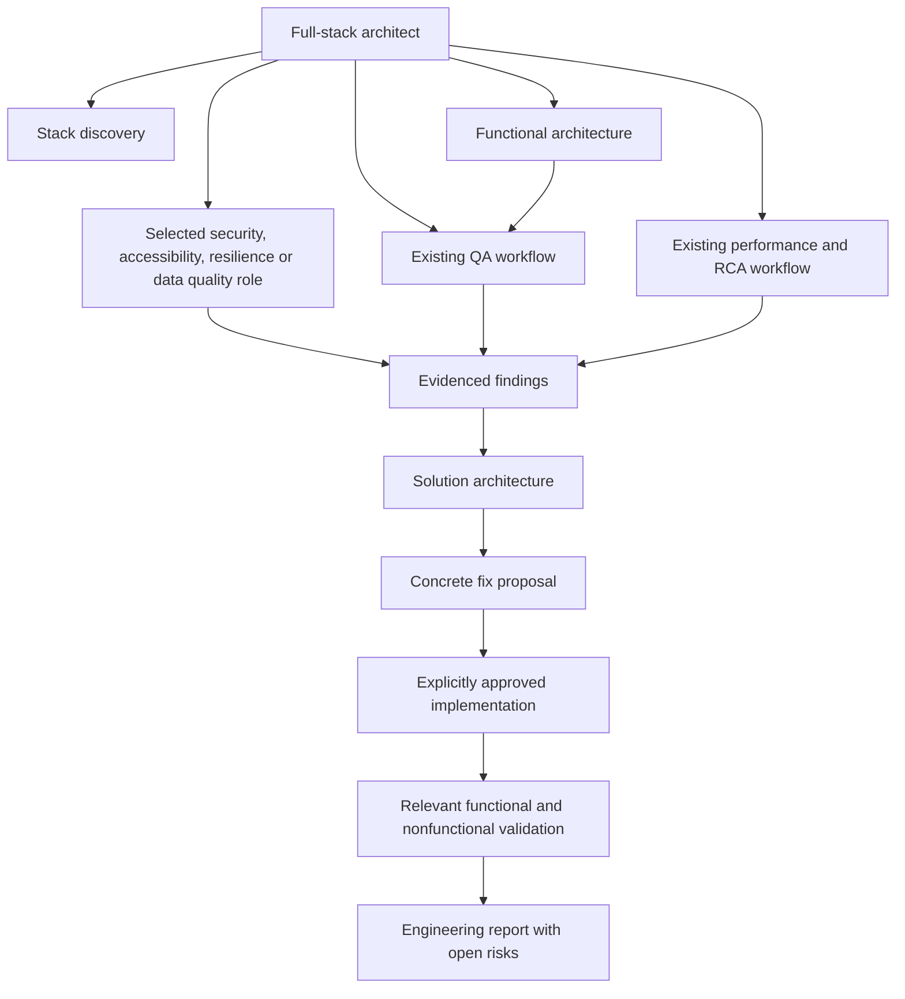

# Small components with explicit handoffs

Orchestrator routes requested work rather than forcing every stage. Skill = reusable procedure; agent = focused role that loads that procedure; recorder = executable browser capture. Shared contract defines artifact identity, state, privacy, approvals and gate semantics. Hosts without native specialist agents execute roles sequentially.

- qa-setup: dependency detection and approved installation.
- qa-playwright / qa-browser: browser and API tool operation.
- qa-recording: passive demonstration capture and session lifecycle.
- qa-knowledge: guided business understanding and versioned manual flows.
- qa-framework: framework architecture, features, data wiring and CI inventory.
- qa-test-design: coverage, scenarios and traceability.
- qa-test-execution: selected manual cases, evidence and owned test data.
- qa-automation: existing framework changes after the evidence gate/explicit override.
- qa-performance: k6/JMeter scripts and confirmed run profiles.
- qa-analysis: evidence normalization and independent cause scores.
- qa-reporting: engineering document from established analysis.
- qa-orchestrate: routing/state/handoffs only.

One writer per artifact, selected IDs and versions in every handoff, no specialist loads every other skill. Shared contract copies are generated from contracts/CONTRACT.md; after changing it synchronize skill reference copies and validate. Portable catalogs are not native platform config schemas. Native format/locations are cited in INSTALLATION.md. Browser API implementation follows the official [BrowserContext documentation](https://playwright.dev/docs/api/class-browsercontext).

The gate helper checks local records and evidence but does not intercept every host's edit tools. Agents must call it before automation edits. Enterprise enforcement against bypass/tampering would require an approved host hook or signed execution/approval service, which is outside this package's scope.

# Engineering extension

qa-engineering routes to qa-performance-engineering or qa-rca. Performance engineering coordinates qa-workload-model → qa-performance / qa-mcp-neoload → qa-telemetry-correlation → qa-bottleneck-analysis → qa-fix-proposal → approved qa-fix-implementation → qa-performance-retest. Formal RCA labels require mechanism proof and agreement across logs, traces, metrics and code analysis. Each MCP product owns its bounded reads and explicitly approved writes. Jira/Confluence share an integration where appropriate but have separate content/workflow roles.

Total: 37 short skills and 37 roles. One skill per responsibility and selected references only. Existing qa-analysis/reporting still own normalization and final reports. See contracts/ENGINEERING.md for artifact identity, approval and evidence rules; integrations/SETUP.md for verified sources/template limitations; docs/GAP-REVIEW.md for residual gaps.

Browser ownership is mandatory across all roles: each recording/UI session owns a dedicated spawned process and QA-only profile; the browser specialist verifies ownership before actions. Unavailable launch capability blocks browser-dependent work. Integrated browsers and personal/shared browser attachments are excluded.

## Product evidence and JMeter reliability

AppDynamics and Datadog have focused product specialists alongside Splunk, Dynatrace and NeoLoad. qa-jmeter handles selected JMX/CLI/JTL work while qa-performance owns tool choice and run confirmation. Only selected provider references are loaded. All use the shared contracts/EVIDENCE.md fallback: MCP, permitted official API/export, then user-run query/command and pasted redacted results. Structural envelope/readiness helpers do not implement a transport, launch tests or enforce external policy.

# Full-stack architecture extension

qa-architect is the new main entry point. It assesses existing architecture, selects quality domains and produces a traceable quality plan. qa-orchestrate retains recording/test/automation workflows; qa-engineering retains performance/RCA/fix routing. Existing stage-specific callers stay valid. Handoffs identify one artifact owner and return results to their caller; they do not bounce requests back through intake.

Eight focused roles add coordination, stack discovery, functional architecture, security, accessibility, resilience, data quality and enterprise solution design. The shared architecture contract defines current-stack assessment, project strategy, quality-domain scope, requirements/findings/solution states and acceptance. Domain references are read only when selected. Enterprise solutions must state evidence, tradeoffs, compatibility, operating assumptions and validation; no implicit rewrite, compliance certification or deployment authority.

Read FULLSTACK-ARCHITECT.md and contracts/ARCHITECTURE.md for usage and record fields. Existing browser, manual gate, evidence fallback, RCA and fix approvals remain in effect. Local architecture_checks.py validates plan consistency only; it does not measure quality or enforce a runtime gate.

# Reviewer corrections — 0.3.1

Solution validation now covers the requirements behind all source findings. Selected native framework tests use qa-test-execution native-runner mode and a separate result contract; manual-flow selection remains its own path. Shared core rules are separated from recording/browser/flow/automation/setup references, with architecture schemas loaded only by artifact writers. Installers use snapshot-checked staged writes and scoped locks; cross-file transactions and enforcement against arbitrary writers remain outside those guarantees. Closed concurrent-user profiles require positive integer counts.
